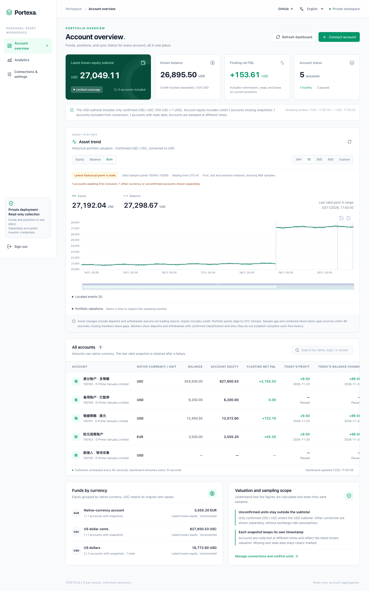
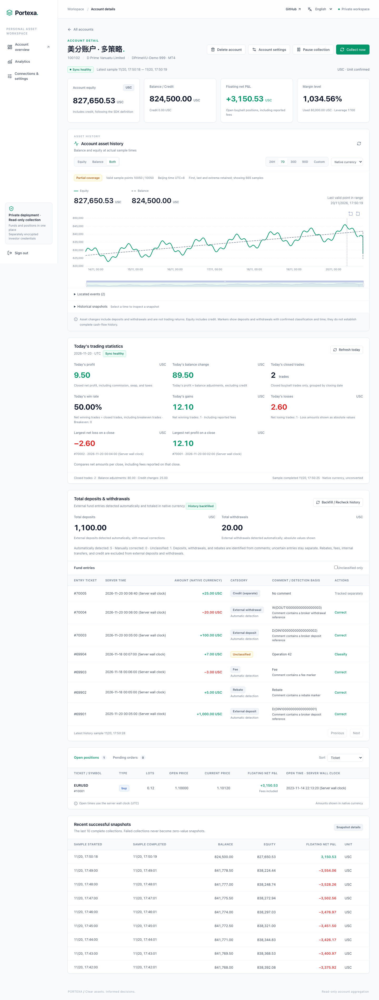

# Portexa

**Your MT4 and MT5 accounts, in one private workspace.**

Portexa is a self-hosted, read-only dashboard for MetaTrader accounts. It connects to MT4 and MT5 trading servers over native TCP. View balances, positions, pending orders, history, daily statistics, cash flows, and performance analysis across accounts.

[English](README.md) · [简体中文](README.zh-CN.md)

[](LICENSE)

## Features

- **Multi-account overview.** View balance, equity, floating net P&L, margin levels, collection status, and sampling times together.
- **Return and risk analytics.** Inspect cash-flow-adjusted net profit, estimated returns, sampled drawdown, daily profit and account comparisons, with per-metric coverage and reconciliation evidence. See [calculation rules](docs/analytics.md).
- **Asset history.** View portfolio trends on the overview and account trends in details, with 24-hour to 90-day and custom ranges, balance/equity controls, native units and confirmed USD conversion. Gaps remain blank; membership changes and verified cash flows are annotated.
- **Explicit currency units.** Confirmed USD and USC accounts contribute to a USD subtotal at 100 USC = 1 USD. Original amounts remain available; other currencies are listed separately.
- **Daily trading statistics.** See net realized profit, balance change, closed trades, and win rate by each trading server’s confirmed date.
- **History and cash flows.** Backfill available history, recognize deposits and withdrawals from explicit order comments, and correct classifications with an audit trail.
- **Scheduled collection.** Choose a 30, 60, 120, or 300-second interval. Failed collections retain the last complete snapshot, with missing and stale data clearly marked.
- **Private deployment.** A single system password, separately encrypted investor credentials, SQLite storage, local backups, and rotating JSONL logs.
- **Chinese and English UI.** Switch languages on the sign-in page or dashboard. Your preference is saved in the browser; account names and original comments retain their source text.
- **Standalone Go SDKs.** Use the [MT4](packages/mt4/README.md) and [MT5](packages/mt5/README.md) clients independently of the dashboard and storage layers.

Broker compatibility depends on the endpoint, protocol profile, and available history. See the [protocol research index](docs/research/README.md) for the scope of recorded live checks and synthetic tests.

## Screenshots

These desktop screenshots show the real UI running against an isolated synthetic server. Names, login numbers, amounts, orders, and comments are examples; no live MT4 connection is used.

### Account overview

Compare the latest known equity subtotal, portfolio asset history, native-currency amounts, and account collection states. The sample includes USD, USC, and EUR accounts, plus paused, stale, and missing snapshots.



### Account details

Inspect account asset history, daily results, margin, cash-flow classification, positions, and recent snapshots. In this synthetic USC example, daily net profit is **9.50 USC**, two closed trades give a **50.00%** win rate, and recognized deposits/withdrawals total **1,100.00 / 20.00 USC**.

<details>
<summary>View the full account details screenshot</summary>



</details>

See [screenshot notes and regeneration commands](docs/screenshots.md) for the Chinese images and the meaning of the example values.

## Quick start

Build on **macOS or Linux** with **Go 1.26+**, **Node.js 22.12+**, and npm. Python 3 is also needed for repository checks. Run these commands from the repository root:

```sh
git clone https://github.com/AuYuHui/Portexa.git
cd Portexa
make web-install
make build
.local/bin/portexa init
.local/bin/portexa serve -dev-http
```

During initialization, enter the system password twice when prompted. It must contain at least **16 Unicode characters**. There is no username or default password.

Open [http://127.0.0.1:8080](http://127.0.0.1:8080) and sign in. `-dev-http` enables HTTP on loopback only; use an HTTPS reverse proxy for deployment.

The build produces `.local/bin/portexa`, `.local/bin/mt4probe`, `.local/bin/mt4verify`, and the static UI in `.local/web/`. Deploy the service binary **together with** the static UI directory; Node.js is only needed at build time. Data, keys, backups, and logs default to the ignored `.local/portexa/` directory.

### Connect an MT4 account

1. Open **Connections & settings → Register server**, then search for the broker or exact MT4 server name.
2. Independently verify the selected endpoint and confirm the remaining connection risk before registration is approved.
3. Choose **Connect account**, provide the MT4 login and **investor password**, confirm the currency unit, and enable collection. The investor password must be **1–16 UTF-8 bytes**; it is separate from the system password.

The native protocol sends password-derived material over TCP before cryptographic server identity can be established. A matching server name or directory entry does not provide that authentication. Review endpoints before sending credentials and follow the [connection and deployment guide](docs/product-start.md).

### Connect an MT5 account

MT5 collection requires a challenge worker and its matching terminal image. On Linux x86_64, use the [worker build and offline check](docs/product-start.md#mt5-采集运行依赖) with the supported ARM64 image you obtain separately.

Open **Connections & settings → Register server**, select **MT5**, and search by broker or server name. Verify the candidate IP and port and confirm the connection risk. If the directory has no usable address, enter a verified IP and port under **Manual entry (advanced)**. Connect with the MT5 login and read-only investor password of **1–32 UTF-16 code units**. [Connection guide](docs/product-start.md#第一次账户接入)

Open **Server time** on the server card and confirm the broker’s time zone to enable deal history, daily statistics, cash flows, and performance analysis. The first confirmation can include a verified historical effective date. MT5 equity is estimated from balance, credit, and net floating profit or loss. [MT5 statistics](docs/account-statistics.md#mt5-成交与资金口径)

### Deploy behind HTTPS

Initialize a private data directory, then run the service behind your reverse proxy:

```sh
.local/bin/portexa init -data /path/to/private-data
.local/bin/portexa serve \
  -data /path/to/private-data \
  -web /path/to/built-web \
  -listen 127.0.0.1:8080 \
  -origin https://portexa.example.com
```

Keep the browser UI and API on the same origin, and preserve the original `Host` and `Origin` headers through the proxy. See [startup, backups, restore, and password reset](docs/product-start.md) for administration details.

## Development

```sh
make web-install
make check
```

`make check` runs structure checks, Go tests and `go vet` across all modules, Python tests for the capture tools and MT5 handshake research, frontend type and translation checks, and the production web build. These checks use synthetic data and loopback services.

For frontend hot reload, run the initialized Go service and Vite in separate terminals:

```sh
# Terminal 1
.local/bin/portexa serve -dev-http -origin http://127.0.0.1:5173

# Terminal 2
npm --prefix web run dev
```

Open [http://127.0.0.1:5173](http://127.0.0.1:5173). See [CONTRIBUTING.md](CONTRIBUTING.md) for code boundaries, test placement, and translation maintenance.

## Standalone protocol modules

[`portexa/mt4`](packages/mt4/README.md) exposes `Probe` and `Fetch`. [`portexa/mt5`](packages/mt5/README.md) exposes `Probe`, `Fetch`, and `FetchHistory`. Both modules return typed protocol data and can be tested with the Go workspace disabled.

```sh
GOWORK=off go -C packages/mt4 test ./...
GOWORK=off go -C packages/mt5 test ./...
```

The application resolves both module paths through local `replace` directives. For a CLI example, see the [MT4 probe](cmd/mt4probe/README.md).

## Documentation

The detailed engineering and operating guides are currently primarily in Chinese. Start with the [documentation index](docs/README.md).

| Guide | Contents |
| --- | --- |
| [Startup and administration](docs/product-start.md) | Build, deployment, server registration, private data, logs, backups, and restore |
| [Account statistics](docs/account-statistics.md) | Daily results, margin, history coverage, and cash-flow classification |
| [Analytics](docs/analytics.md) | Returns, drawdown, calendar, and account comparisons |
| [Asset trends](docs/asset-trends.md) | Portfolio and account charts, units, and gaps |
| [Server discovery](docs/server-discovery.md) | Directory search, independent verification, and endpoint revisions |
| [Screenshot examples](docs/screenshots.md) | English/Chinese desktop images, sample values, and reproducible capture |
| [Architecture](docs/architecture.md) | Project structure, module boundaries, and independent SDK distribution |
| [Validation records](docs/phase1-validation.md) | Recorded synthetic, browser, and performance checks |
| [Protocol research](docs/research/README.md) | Historical research and broker compatibility evidence |

## Contributing

Issues and pull requests are welcome. Describe the behavior you want to change and include a synthetic reproduction when reporting a bug. Keep real credentials, endpoints, account data, and packet captures out of public reports. Read the [contribution guide](CONTRIBUTING.md) before making changes.

## License

Portexa is released under the [MIT License](LICENSE). Both SDKs include license copies and third-party notices. [MT4 notices](packages/mt4/THIRD_PARTY_NOTICES.md) · [MT5 notices](packages/mt5/THIRD_PARTY_NOTICES.md)

## Star History

[View Portexa on Star History](https://www.star-history.com/?type=date&repos=AuYuHui%2FPortexa).
