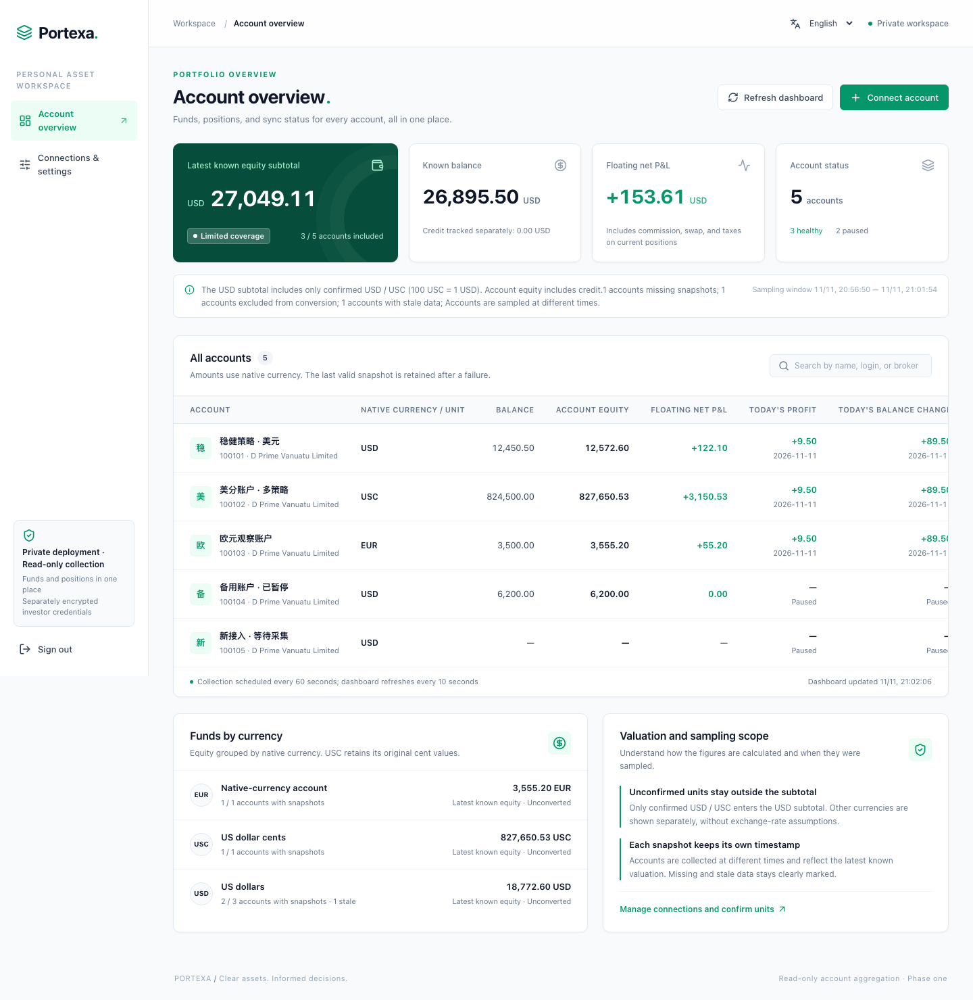
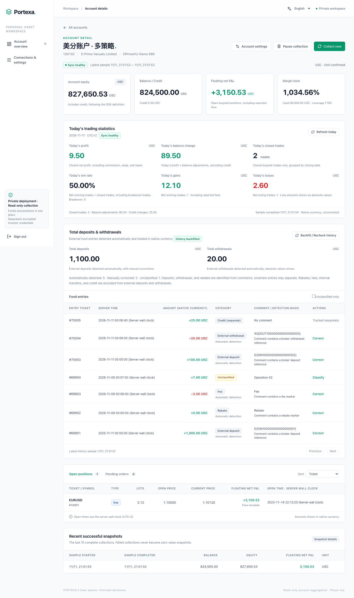

# Portexa

**Your MT4 accounts, in one private workspace.**

Portexa is a self-hosted, read-only dashboard for multiple MetaTrader 4 accounts. Track funds, positions, daily results, and cash flows through a native Go protocol client, without an MT4 terminal, Wine, an Expert Advisor, or a third-party account aggregation service.

[English](README.md) · [简体中文](README.zh-CN.md)

[](LICENSE)

## Features

- **Multi-account overview.** View balance, equity, floating net P&L, margin levels, collection status, and sampling times together.
- **Explicit currency units.** Confirmed USD and USC accounts contribute to a USD subtotal at 100 USC = 1 USD. Original amounts remain available; other currencies are listed separately.
- **Daily trading statistics.** See net realized profit, balance change, closed trades, win rate, and gains/losses by MT4 server date.
- **History and cash flows.** Backfill available history, recognize deposits and withdrawals from explicit order comments, and correct classifications with an audit trail.
- **Scheduled collection.** Choose a 30, 60, 120, or 300-second interval. Failed collections retain the last complete snapshot, with missing and stale data clearly marked.
- **Private deployment.** A single system password, separately encrypted investor credentials, SQLite storage, local backups, and rotating JSONL logs.
- **Chinese and English UI.** Switch languages on the sign-in page or dashboard. Your preference is saved in the browser; account names and original comments retain their source text.
- **Standalone Go SDK.** Use `Probe` and `Fetch` from `packages/mt4` independently of the dashboard and storage layers.

The current release focuses on account monitoring and cash-flow statistics. Return curves, drawdown analytics, and snapshot archival are planned. Compatibility depends on the broker's protocol profile and available history; see the [validation records](docs/research/README.md) for the tested scope and dates.

## Screenshots

These desktop screenshots show the real UI running against an isolated synthetic server. Names, login numbers, amounts, orders, and comments are examples; no live MT4 connection is used.

### Account overview

Compare the latest known equity subtotal, native-currency amounts, and account collection states. The sample includes USD, USC, and EUR accounts, plus paused, stale, and missing snapshots.



### Account details

Inspect daily results, margin, cash-flow classification, positions, and recent snapshots. In this synthetic USC example, daily net profit is **9.50 USC**, two closed trades give a **50.00%** win rate, and recognized deposits/withdrawals total **1,100.00 / 20.00 USC**.

<details>
<summary>View the full account details screenshot</summary>



</details>

See [screenshot notes and regeneration commands](docs/screenshots.md) for the Chinese images and the meaning of the example values.

## Quick start

Build on **macOS or Linux** with **Go 1.26+**, **Node.js 22.12+**, and npm. Python 3 is also needed for repository checks. Run these commands from the repository root:

```sh
git clone https://github.com/AuYuHui/Portexa.git
cd Portexa
make web-install
make build
.local/bin/portexa init
.local/bin/portexa serve -dev-http
```

During initialization, enter the system password twice when prompted. It must contain at least **16 Unicode characters**. There is no username or default password.

Open [http://127.0.0.1:8080](http://127.0.0.1:8080) and sign in. `-dev-http` enables HTTP on loopback only; use an HTTPS reverse proxy for deployment.

The build produces `.local/bin/portexa`, `.local/bin/mt4probe`, `.local/bin/mt4verify`, and the static UI in `.local/web/`. Deploy the service binary **together with** the static UI directory; Node.js is only needed at build time. Data, keys, backups, and logs default to the ignored `.local/portexa/` directory.

### Connect an account

1. Open **Connections & settings → Register server**, then search for the broker or exact MT4 server name.
2. Independently verify the selected endpoint and confirm the remaining connection risk before registration is approved.
3. Choose **Connect account**, provide the MT4 login and **investor password**, confirm the currency unit, and enable collection. The investor password must be **1–16 UTF-8 bytes**; it is separate from the system password.

The native protocol sends password-derived material over TCP before cryptographic server identity can be established. A matching server name or directory entry does not provide that authentication. Review endpoints before sending credentials and follow the [connection and deployment guide](docs/product-start.md).

### Deploy behind HTTPS

Initialize a private data directory, then run the service behind your reverse proxy:

```sh
.local/bin/portexa init -data /path/to/private-data
.local/bin/portexa serve \
  -data /path/to/private-data \
  -web /path/to/built-web \
  -listen 127.0.0.1:8080 \
  -origin https://portexa.example.com
```

Keep the browser UI and API on the same origin, and preserve the original `Host` and `Origin` headers through the proxy. See [startup, backups, restore, and password reset](docs/product-start.md) for administration details.

## Development

```sh
make web-install
make check
```

`make check` covers structure and file-size rules, Go tests across all modules, Python capture-tool tests, `go vet`, frontend type checks, translation checks, and the production web build. Ordinary checks use synthetic data and loopback services; they do not sign in to live trading servers.

For frontend hot reload, run the initialized Go service and Vite in separate terminals:

```sh
# Terminal 1
.local/bin/portexa serve -dev-http -origin http://127.0.0.1:5173

# Terminal 2
npm --prefix web run dev
```

Open [http://127.0.0.1:5173](http://127.0.0.1:5173). See [CONTRIBUTING.md](CONTRIBUTING.md) for code boundaries, test placement, and translation maintenance.

## Standalone MT4 module

[`packages/mt4`](packages/mt4/README.md) contains the independent `portexa/mt4` module. Its public API is `Probe`, `Fetch`, and typed protocol data. It does not read application configuration, persist data, or emit CLI output.

```sh
GOWORK=off go -C packages/mt4 test ./...
GOWORK=off go -C packages/mt4 vet ./...
```

Module paths are currently local project names. Use this checkout and its local module replacement; a public `go get` module path has not been configured. See the [SDK reference](packages/mt4/README.md) and [probe CLI](cmd/mt4probe/README.md) for usage and protocol limits.

## Documentation

The detailed engineering and operating guides are currently primarily in Chinese. Start with the [documentation index](docs/README.md).

| Guide | Contents |
| --- | --- |
| [Startup and administration](docs/product-start.md) | Build, deployment, server registration, private data, logs, backups, and restore |
| [Account statistics](docs/account-statistics.md) | Daily results, margin, history coverage, and cash-flow classification |
| [Server discovery](docs/server-discovery.md) | Directory search, independent verification, and endpoint revisions |
| [Screenshot examples](docs/screenshots.md) | English/Chinese desktop images, sample values, and reproducible capture |
| [Architecture](docs/architecture.md) | Project structure, module boundaries, and independent SDK distribution |
| [Validation](docs/phase1-validation.md) | Synthetic acceptance, browser checks, and recorded performance evidence |
| [Product plan](docs/product-plan.md) | Implemented scope and future analytics roadmap |
| [Protocol research](docs/research/README.md) | Historical research and broker compatibility evidence |

## Contributing

Issues and pull requests are welcome. Describe the behavior you want to change and include a synthetic reproduction when reporting a bug. Keep real credentials, endpoints, account data, and packet captures out of public reports. Read the [contribution guide](CONTRIBUTING.md) before making changes.

## License

Portexa is released under the [MIT License](LICENSE). The standalone SDK includes its own [license copy](packages/mt4/LICENSE). Third-party dependencies retain their respective licenses; the SDK's bundled notice is in [THIRD_PARTY_NOTICES.md](packages/mt4/THIRD_PARTY_NOTICES.md).

## Star History

[View Portexa on Star History](https://www.star-history.com/?type=date&repos=AuYuHui%2FPortexa).
