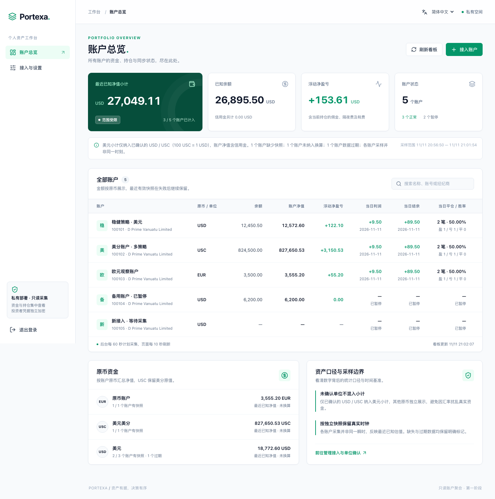
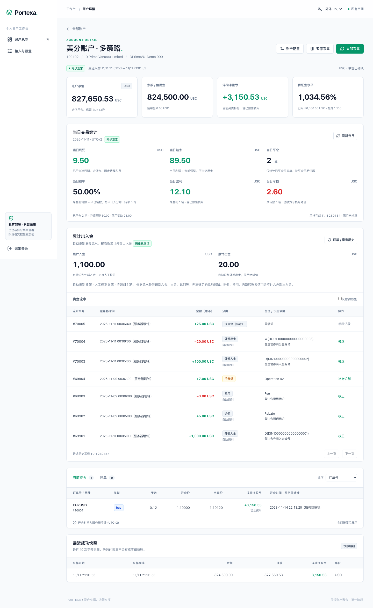

# Portexa

**在自己的工作台，一览多个 MT4 账户。**

Portexa 是可私有部署的多账户只读看板。通过原生 Go 协议客户端聚合资金、持仓、当日交易和出入金，无需 MT4 终端、Wine、EA 或第三方账户聚合服务。主工程使用 Go、GORM、SQLite 和 Vue；MT4 协议 SDK 可独立使用。

[English](README.md) · [简体中文](README.zh-CN.md)

[](LICENSE)

## 功能

- **多账户总览**：集中查看余额、净值、浮动净盈亏、保证金水平、采集状态和采样时间。
- **明确币种单位**：确认单位后的 USD、USC 按 100 USC = 1 USD 计入美元小计，保留原币金额；其他币种单列。
- **当日交易统计**：按 MT4 服务器日期展示当日净利润、结余、平仓笔数、胜率和盈利/亏损。
- **历史与出入金**：按窗口回填可用历史，依据明确订单备注识别出入金，支持人工校正及修订追踪。
- **周期采集**：可选 30、60、120、300 秒。失败保留最后完整快照，明确标记缺失与过期数据。
- **私有部署**：单用户系统密码登录、独立加密投资者凭据、SQLite、本地备份和轮转 JSONL 日志。
- **中英文界面**：登录页和顶部均可切换，偏好保存在当前浏览器；账户名称和原始备注保留原文。
- **独立 Go SDK**：`packages/mt4` 对外提供 `Probe`、`Fetch` 及协议数据类型，不依赖看板或存储。

当前聚焦账户监控与资金统计，收益率曲线、回撤分析和快照归档仍属后续阶段。经纪商兼容性取决于协议 profile 和服务端保留的历史；已验证范围和日期见[研究与验收记录](docs/research/README.md)。

## 桌面截图

以下为真实界面连接独立合成服务生成的桌面截图。账户名称、登录号、金额、订单和备注均为示例，生成时不连接真实 MT4 服务。

### 账户总览

展示最近已知净值小计、原币资金与账户采集状态。示例包含 USD、USC、EUR，以及暂停、过期和等待首次采集的账户，缺失数据不计作零。



### 账户详情

查看当日交易、保证金、资金分类、持仓和近期快照。合成美分账户的当日净利润为 **9.50 USC**，两笔平仓的胜率为 **50.00%**，已识别累计入金/出金为 **1,100.00 / 20.00 USC**；这些详情金额保持美分单位。

<details>
<summary>展开完整账户详情截图</summary>



</details>

截图口径、英文版本和重新生成命令见[截图示例说明](docs/screenshots.md)。

## 快速开始

支持 **macOS / Linux**；构建需要 **Go 1.26+、Node.js 22.12+ 和 npm**，仓库检查还需要 Python 3。在仓库根目录执行：

```sh
git clone https://github.com/AuYuHui/Portexa.git
cd Portexa
make web-install
make build
.local/bin/portexa init
.local/bin/portexa serve -dev-http
```

初始化时在终端输入两次系统密码，至少 **16 个 Unicode 字符**，无用户名、无默认密码。浏览器访问 [http://127.0.0.1:8080](http://127.0.0.1:8080)。`-dev-http` 仅允许环回 HTTP，生产使用 HTTPS 反向代理。

构建产物包括 `.local/bin/portexa`、`.local/bin/mt4probe`、`.local/bin/mt4verify` 及 `.local/web/`。部署时同时携带服务二进制和前端静态目录，运行时不需要 Node.js。数据、密钥、备份及日志默认保存在被忽略的 `.local/portexa/`。

### 第一次接入账户

1. 打开“接入与设置 → 登记服务器”，搜索经纪商或准确的 MT4 服务器名称。
2. 独立核验候选接入点，确认该修订的剩余连接风险后完成登记。
3. 选择“接入账户”，填写 MT4 登录号和**投资者只读密码**，确认币种单位并启用采集。投资者密码为 **1–16 个 UTF-8 字节**，与系统密码不同。

原生协议在建立密码学服务端身份认证前，已通过 TCP 发送密码派生材料；名称一致或目录收录不能替代身份认证。发送凭据前核验接入点，并按[启动与部署说明](docs/product-start.md)配置出站策略。

### 生产部署

初始化私有数据目录，再将服务放在 HTTPS 反向代理后：

```sh
.local/bin/portexa init -data /path/to/private-data
.local/bin/portexa serve \
  -data /path/to/private-data \
  -web /path/to/built-web \
  -listen 127.0.0.1:8080 \
  -origin https://portexa.example.com
```

浏览器页面与 API 保持同源，反向代理保留原始 `Host`、`Origin`。备份、恢复、密码重置和日志规则见[启动与管理](docs/product-start.md)。

## 开发与验证

```sh
make web-install
make check
```

`make check` 包含目录与文件行数检查、各模块 Go 测试、Python 采集工具测试、`go vet`、前端类型检查、翻译检查和生产构建。普通检查仅使用合成数据和环回服务，不登录真实交易账户。

前端热更新在两个终端分别执行，Go 服务须已完成初始化与构建：

```sh
# 终端一
.local/bin/portexa serve -dev-http -origin http://127.0.0.1:5173

# 终端二
npm --prefix web run dev
```

浏览器访问 [http://127.0.0.1:5173](http://127.0.0.1:5173)。代码边界、测试位置和翻译维护见[贡献指南](CONTRIBUTING.md)。

## 独立协议模块

[`packages/mt4`](packages/mt4/README.md) 的模块名为 `portexa/mt4`，对外提供 `Probe`、`Fetch` 及类型化协议数据，不读取业务配置、不落库、不输出命令行结果。

```sh
GOWORK=off go -C packages/mt4 test ./...
GOWORK=off go -C packages/mt4 vet ./...
```

当前模块按项目本地路径命名，通过仓库中的 `replace` 接入，尚未配置公开 `go get` 模块地址。调用接口和限制见[SDK 说明](packages/mt4/README.md)，联网与离线验证见[命令行说明](cmd/mt4probe/README.md)。

## 文档导航

完整入口见[文档索引](docs/README.md)。

| 文档 | 内容 |
| --- | --- |
| [启动与管理](docs/product-start.md) | 构建、部署、接入、私有数据、日志、备份与恢复 |
| [账户统计](docs/account-statistics.md) | 当日统计、保证金、历史覆盖及资金分类 |
| [服务器发现](docs/server-discovery.md) | 目录搜索、独立核验和接入点修订 |
| [截图示例](docs/screenshots.md) | 中英文桌面图、数值说明和复现命令 |
| [工程结构](docs/architecture.md) | 目录、依赖边界与 SDK 独立分发 |
| [验收记录](docs/phase1-validation.md) | 合成验收、浏览器回归和历史性能证据 |
| [产品方案](docs/product-plan.md) | 已实现范围与后续分析规划 |
| [协议研究](docs/research/README.md) | 历史研究和经纪商兼容性证据 |

## 参与贡献

欢迎提交 Issue 和 Pull Request。说明问题或预期行为，尽量提供合成复现；真实凭据、接入地址、账户数据及报文不要放入公开报告。修改前请阅读[贡献指南](CONTRIBUTING.md)。

## 开源协议

Portexa 使用 [MIT License](LICENSE)，独立 SDK 也保留[许可证副本](packages/mt4/LICENSE)。第三方依赖遵循各自许可，SDK 的第三方许可原文见[声明](packages/mt4/THIRD_PARTY_NOTICES.md)。

## Star History

[查看 Portexa 的 Star 历史](https://www.star-history.com/?type=date&repos=AuYuHui%2FPortexa)。
