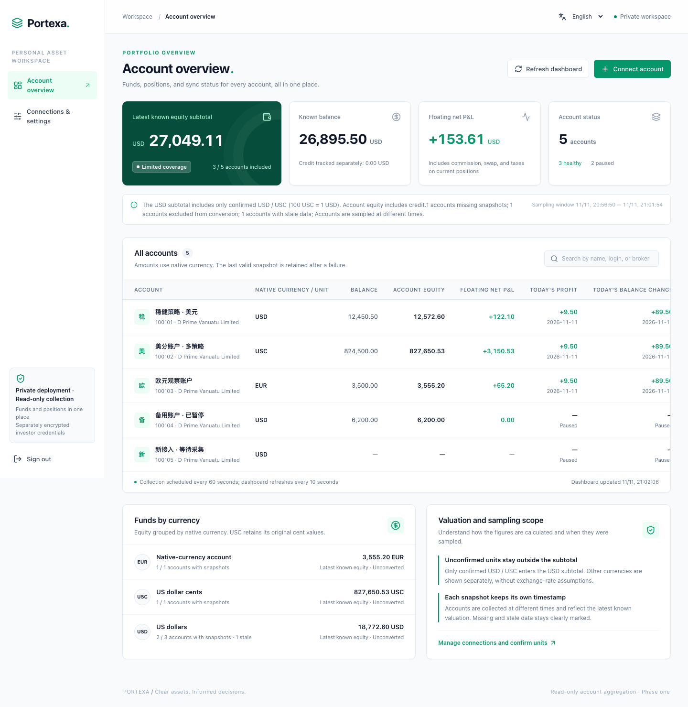
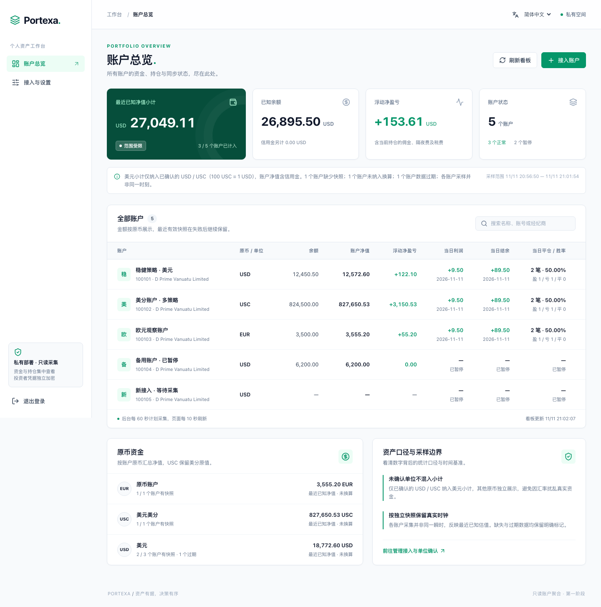
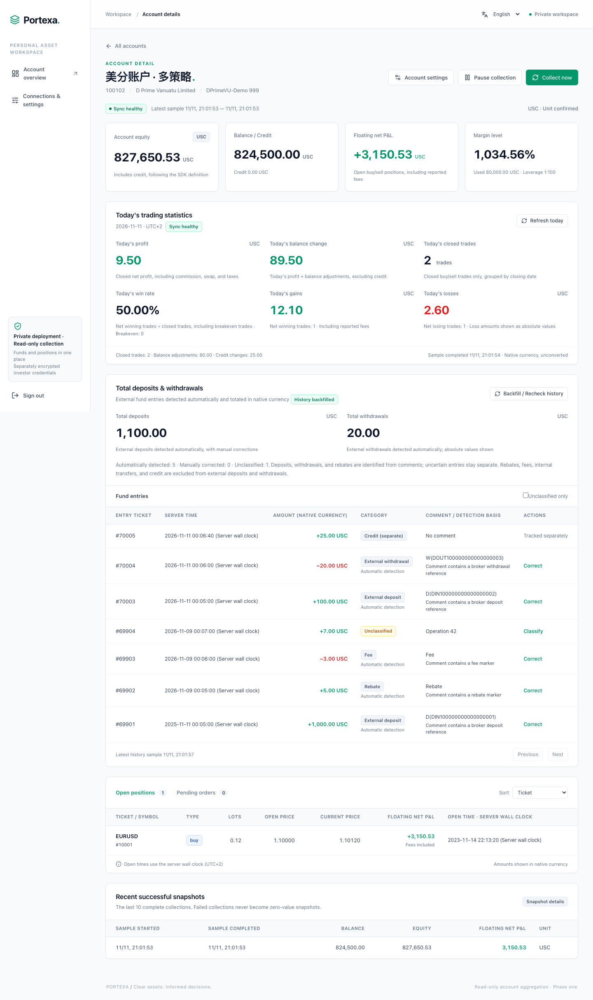
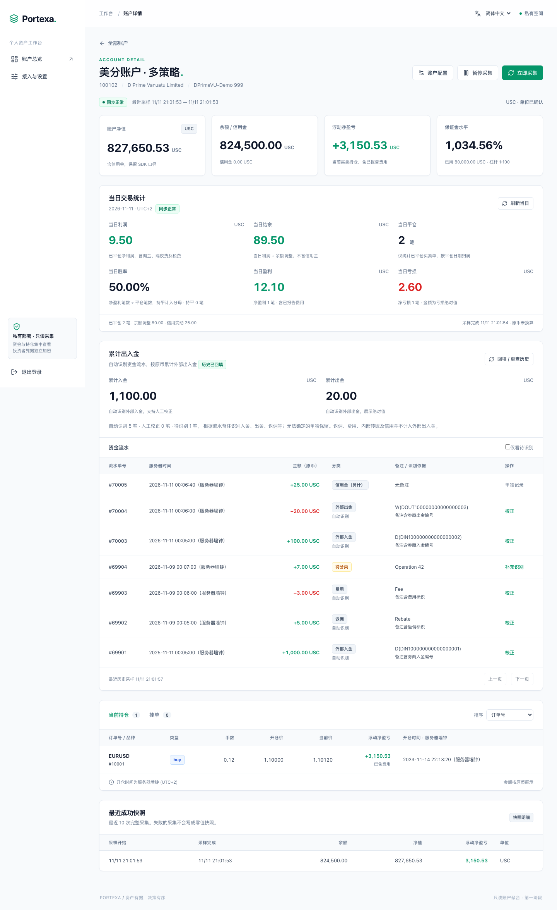

# 桌面截图示例 / Desktop screenshots

[English README](../README.md) · [中文 README](../README.zh-CN.md) · [文档索引](README.md)

这些截图由仓库当前构建的真实网页和 `tests/e2e/server` 合成服务生成，使用 1440 × 1000 桌面视口并保存完整页面。截图不包含真实凭据、真实账户明细或私有接入地址，也不以线上经纪商连接作为生成条件。

These are full-page captures of the real application at a 1440 × 1000 desktop viewport, backed by the repository's isolated synthetic server. Account names, login numbers, orders, comments, and amounts are fictional. No live MT4 server is contacted. User-supplied account names retain their original text in both UI languages.

## 账户总览 / Account overview



| 示例 / Example | 说明 / Meaning |
| --- | --- |
| USD / USC | 单位确认后按 100 USC = 1 USD 纳入美元小计；原始美分金额仍保留。 Confirmed units contribute to the USD subtotal while retaining native amounts. |
| EUR | 原币展示，不假设汇率，也不纳入美元小计。 Shown separately without an assumed exchange rate. |
| 已暂停 · 过期 / Paused · Stale | 保留最后完整快照及时间，不冒充最新结果。 The last complete snapshot remains visible with its actual sampling time. |
| 等待首次采集 / No first snapshot | 缺失用 `—` 表示，不替换为零。 Missing amounts are not replaced with zero. |
| 最近已知小计 / Latest known subtotal | 各账户采样时间不同，小计不表示同一报价时刻的精确估值。 Accounts have different sampling windows. |

<details>
<summary>查看中文版 / View Chinese version</summary>



</details>

## 账户详情 / Account details

示例打开登录号为 `100102` 的合成 USC 账户。以下数值用于说明展示口径，不代表真实账户或收益承诺。

The example opens the synthetic USC account with login `100102`. Values illustrate the reporting definitions and are not live performance results.

| 指标 / Metric | 合成示例 / Synthetic value | 解释 / Interpretation |
| --- | --- | --- |
| 当日净利润 / Daily net profit | 9.50 USC | 当日平仓买卖的利润加佣金、隔夜费和税费。 Closed-trade P&L including reported charges. |
| 当日结余 / Daily balance change | 89.50 USC | 净利润加当日余额类净变动，信用另计。 Daily net profit plus balance operations, excluding credit. |
| 平仓笔数 / Closed trades | 2 | 按服务器日期统计买卖平仓。 Closed buy/sell trades on the server date. |
| 胜率 / Win rate | 50.00% | 一笔净盈利、一笔净亏损。 One net winner and one net loser. |
| 累计入金 / Total deposits | 1,100.00 USC | 明确入金备注识别出的合计。 Recognized deposit comments. |
| 累计出金 / Total withdrawals | 20.00 USC | 明确出金备注识别出的合计。 Recognized withdrawal comments. |
| 待识别流水 / Unclassified operation | `Operation 42` | 不将模糊备注自动当作入金，可人工核对分类。 Ambiguous comments require review. |

金额保留账户原币；详情中的 USC 金额不会再次除以 100。当日统计使用服务器自然日，页面会同时说明服务器日期、采用的时间规则及采样时间。累计出入金受历史覆盖和分类状态约束，信用、返佣和费用不混入外部出入金。

Amounts retain the account's native unit. Daily statistics use the MT4 server date; cash-flow totals depend on available history and classification. Credit, rebates, and fees are tracked separately from external deposits and withdrawals.

<details>
<summary>英文账户详情 / English account details</summary>



</details>

<details>
<summary>中文账户详情 / Chinese account details</summary>



</details>

完整统计定义见[账户统计](account-statistics.md)，操作步骤见[启动与管理](product-start.md)。

## 重新生成 / Regenerate

在仓库根目录构建网页和合成服务，再运行截图脚本。Playwright 仅用于生成文档图片，不是产品运行依赖。

From the repository root, build the UI and synthetic fixture, then run the capture script. Playwright is a documentation tool, not a production dependency.

```sh
make web-install
make web-build
python3 -m venv .local/venv-browser
.local/venv-browser/bin/pip install playwright==1.65.0
.local/venv-browser/bin/python -m playwright install chromium
GOWORK=off go build -o .local/bin/e2e-server ./tests/e2e/server
.local/venv-browser/bin/python tests/e2e/screenshots.py
```

脚本自动启动新的合成进程，选择环回端口和临时数据库，使用固定合成登录信息，等待当日统计和历史回填完成，再保存以下四张图；退出时关闭浏览器和合成服务并清理临时数据库，不读取产品的私有运行目录。

The script starts a fresh loopback fixture with a temporary database, signs in using synthetic credentials, waits for daily results and history backfill, and writes the four files below. It then closes the browser and server and removes the temporary database. It does not read the application's private data directory.

| 文件 / File | 页面 / View |
| --- | --- |
| `screenshots/overview-en.png` | 英文总览 / English overview |
| `screenshots/account-en.png` | 英文详情 / English account details |
| `screenshots/overview-zh-CN.png` | 中文总览 / Chinese overview |
| `screenshots/account-zh-CN.png` | 中文详情 / Chinese account details |

截图脚本同时检查示例数值、缺失/过期状态、整页横向溢出和页面脚本错误。此检查只证明合成页面可展示，不替代生产部署或真实协议兼容性验收。截图中的日期和采样时间随生成时刻变化。
